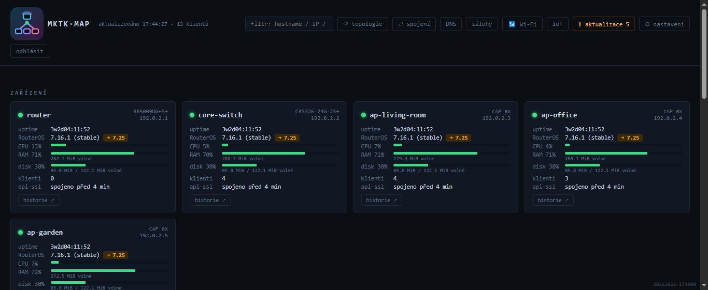
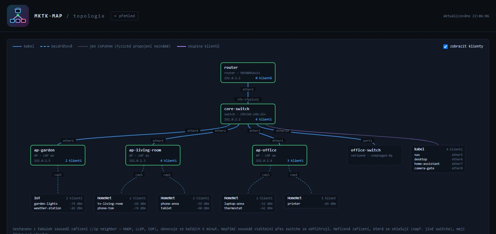
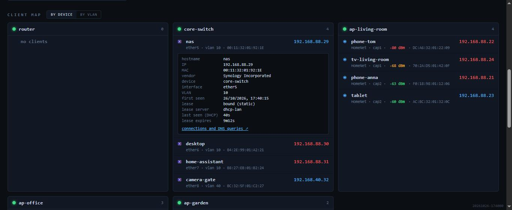
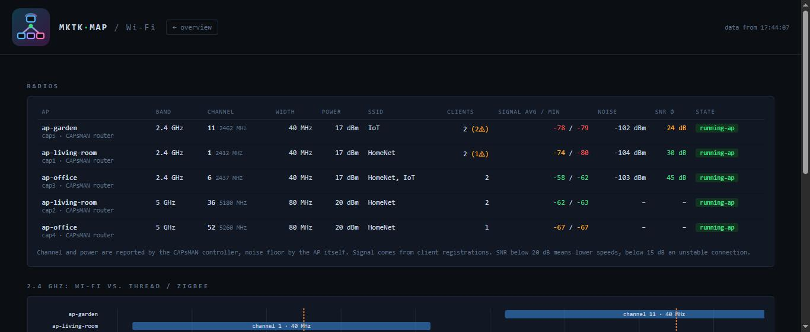

<p align="center"></p>

# mktk-map

[English](README.md) · **Čeština**

Webový přehled pro menší síť zařízení **MikroTik** (routery, switche, access pointy), který si provozujete sami.
Ukazuje stav každého zařízení, živou mapu všech klientů (Wi-Fi i kabel, s IP a jménem z DHCP), jak jsou
zařízení mezi sebou propojená, a přidává nástroje pro aktualizace, zálohy konfigurace, analýzu Wi-Fi,
přehled spojení a DNS dotazů, IoT whitelist ve firewallu a upozornění do Home Assistanta.

> [!WARNING]
> **Celý projekt je vibecodovaný.** Veškerý kód napsala AI (Claude) a autor z něj neviděl ani písmenko.
> Na autorově síti funguje, ale žádný člověk ho nekontroloval. Počítejte s tím, než ho spustíte, zvlášť proto,
> že drží přihlašovací údaje k vašim MikroTikům a umí měnit jejich konfiguraci (aktualizace, pravidla IoT
> firewallu). Používáte ho na vlastní riziko.



## Funkce

- **Přehled zařízení** — CPU, RAM, disk, teplota, uptime, verze RouterOS/firmware a dostupné aktualizace.
- **Mapa klientů** — všichni klienti podle AP/portu switche nebo podle VLAN; signál, rychlosti, historie roamingu, výrobce.
- **Topologie** — automaticky kreslená mapa propojení zařízení (porty, kabel vs. bezdrátově) z neighbor discovery (MNDP/LLDP/CDP) a CAPsMANu, volitelně i s připojenými klienty.
- **Aktualizace** — upgrade RouterOS a firmware po jednom zařízení, se zálohou před instalací a úplným záznamem průběhu.
- **Zálohy konfigurace** — `/export` přes SSH každých 6 h a po každé změně, s historií a rozdíly.
- **Wi-Fi** — kanály, šířka, výkon, šum, SNR, slabí klienti a překryv 2,4 GHz s kanály Threadu/Zigbee.
- **Spojení a DNS** — živý přehled spojení po klientech a analýza DNS dotazů (přes syslog z routeru).
- **IoT whitelist** — co se IoT zařízení snaží kontaktovat, povolení domén/IP/portů a časově omezený režim „učení“.
- **Upozornění** — zařízení offline, vysoké CPU/teplota, nefunkční rádio, změna konfigurace, nová IoT doména… přes webhook do Home Assistanta.
- **API tokeny jen pro čtení** — např. detekce přítomnosti v Home Assistantu.
- **Anglické a české UI** — volba v nastavení; další jazyk = jeden JSON soubor.

| Topologie | Mapa klientů | Wi-Fi |
|---|---|---|
|  |  |  |

## Jak to funguje

mktk-map běží v Dockeru vedle [Caddy](https://caddyserver.com/) (HTTPS). K zařízením se připojuje přes
RouterOS **API-SSL** (port 8729) účtem **jen pro čtení** a ke každému drží jedno trvalé spojení. Rychlý poll běží
každých 30 s (prostředky, rozhraní, Wi-Fi registrace, bridge hosts, DHCP, ARP, IPv6 sousedé), pomalý každých
5 min (identita, verze, teplota, rádia, CAPsMAN, sousedé). Data se ukládají do SQLite. Self-signed certifikáty
zařízení se při prvním spojení zapamatují (TOFU).

Změny na zařízeních (aktualizace, IoT pravidla, zapnutí DNS logu) vyžadují admin údaje, které zadáte v UI;
drží se **jen v paměti serveru po dobu 30 minut** a nikam se neukládají ani nelogují.

## Požadavky

- Docker s Docker Compose v2.
- Zařízení MikroTik s RouterOS 7 (RouterOS 6 většinou funguje také).
- Na každém zařízení: služba `api-ssl` s certifikátem a účet `monitor` jen pro čtení —
  viz [První spuštění](docs/cs/prvni-spusteni.md#2-příprava-zařízení-mikrotik).

## Instalace

```sh
git clone https://github.com/JsemOndra/mktk-map.git
cd mktk-map
cp .env.example .env
cp config.example.yaml config.yaml
```

1. Upravte `.env`: heslo monitorovacího účtu, přihlašovací jméno do webu, `PROXY_SECRET` (náhodný řetězec)
   a `MKTK_HOST` (IP serveru).
2. Vygenerujte hash hesla do webu a vložte ho do `.env` jako `APP_PASS_HASH`:
   ```sh
   docker compose run --rm --no-deps mktk-map python auth.py
   ```
3. Upravte `config.yaml`: vaše zařízení (jméno, IP, role) — nebo je přidejte později v UI.

## Spuštění

```sh
docker compose up -d --build
```

Otevřete `https://<MKTK_HOST>:8443` a přihlaste se. Caddy používá vlastní lokální certifikační autoritu; varování
prohlížeče odstraníte importem jejího kořenového certifikátu:

```sh
docker compose cp caddy:/data/caddy/pki/authorities/local/root.crt ./mktk-root.crt
```

Port `8080` slouží jen pro API s tokeny (např. Home Assistant); UI je dostupné jen přes HTTPS.

**Vyzkoušení bez MikroTiků:** `pip install -r requirements.txt && python tools/demo.py --lang cs`
spustí demo s vymyšlenými daty na `http://127.0.0.1:8080` (jméno `demo`, heslo `demo`).

## Konfigurace

| Kde | Co |
|---|---|
| `.env` | tajné údaje: monitorovací účet, přihlášení do webu (`APP_USER`, `APP_PASS_HASH`), `PROXY_SECRET`, `MKTK_HOST` |
| `config.yaml` | zařízení, zdroj DHCP leases, webhook, upozornění, kanály Thread/Zigbee, nastavení IoT, uchování dat, jazyk |
| ⚙ nastavení v UI | vše z `config.yaml`, co se často mění — ukládá se zpět do `config.yaml` (komentáře zůstanou) |

`.env` i `config.yaml` git ignoruje. Všechny sekce `config.yaml` jsou popsané v
[docs/cs/funkce.md](docs/cs/funkce.md).

## Změna jazyka

Na přehledu otevřete **⚙ nastavení** a nahoře vyberte jazyk. Volba se uloží do `config.yaml`
(`language: cs`), takže přežije restart a platí pro všechny uživatele i pro texty upozornění posílaných do
Home Assistanta. Výchozí je angličtina. Texty už uložené v historii (upozornění, průběh úloh) zůstávají v jazyce,
ve kterém vznikly.

Nový jazyk přidáte zkopírováním `app/locales/en.json` např. na `app/locales/de.json`, přeložením hodnot a
restartem — viz [CONTRIBUTING.md](CONTRIBUTING.md).

## Dokumentace

- [První spuštění](docs/cs/prvni-spusteni.md) — instalace, příprava zařízení MikroTik
- [Funkce](docs/cs/funkce.md) — všechny stránky, integrace s Home Assistantem, API, přehled konfigurace
- [Řešení problémů](docs/cs/reseni-problemu.md)

## Bezpečnost

- Monitorovací účet je jen pro čtení; API-SSL a SSH na zařízeních omezte na IP serveru.
- Web má jednoho uživatele s heslem hashovaným scryptem; session je HttpOnly, Secure, SameSite=Strict cookie.
- API tokeny jsou jen pro čtení (GET), ukládají se jako SHA-256 hash a zobrazí se jen jednou. Ve výchozím stavu
  čtou jen `/api/snapshot`, `/api/presence/…`, `/api/alerts` a `/api/events` (`api_token_paths` v `config.yaml`).
- Po 10 neúspěšných přihlášeních z jedné adresy se z ní přihlášení na 15 minut zablokuje.
- Bez `PROXY_SECRET`, `APP_USER` a `APP_PASS_HASH` aplikace odmítne start (kromě `MKTK_DEV=1`).
- `API_BIND` v `.env` omezí port 8080 na jednu adresu serveru.
- Kontejner neběží jako root, ale jako neprivilegovaný uživatel (uid 10001).
- Provozujte v důvěryhodné síti; aplikace není určená k vystavení do internetu.
- Našli jste bezpečnostní chybu? Nahlaste ji prosím neveřejně, viz [SECURITY.md](SECURITY.md).

## Licence

[MIT](LICENSE) © JsemOndra

mktk-map je nezávislý projekt, který není spojený se společností MikroTik ani jí podporovaný.
MikroTik a RouterOS jsou ochranné známky svého vlastníka.
