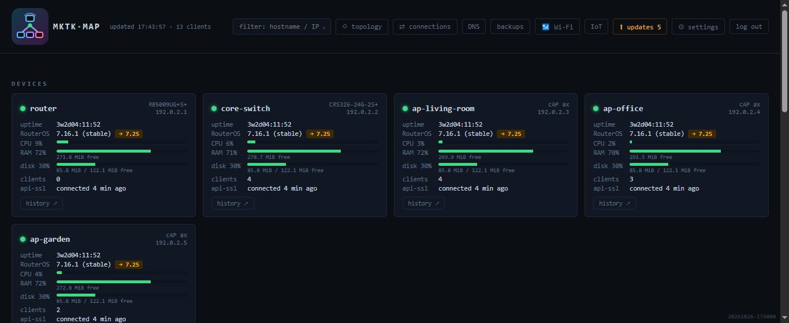
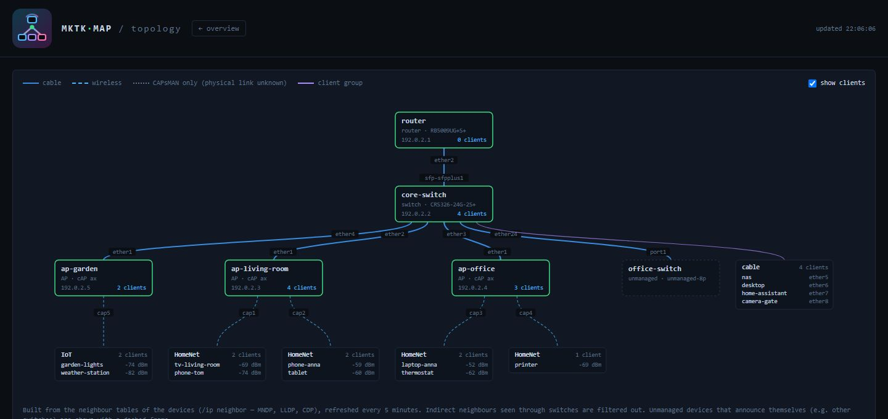

<p align="center"></p>

# mktk-map

**English** · [Čeština](README.cs.md)

A self-hosted web dashboard for a small fleet of **MikroTik** routers, switches and access points.
It shows the state of every device, a live map of all clients (Wi-Fi and wired, with IP and hostname
from DHCP), how the devices are interconnected, and adds tools for updates, configuration backups,
Wi-Fi analysis, DNS/connection insight, an IoT firewall whitelist and Home Assistant alerts.

> [!WARNING]
> **This project is entirely vibe-coded.** All of the code was written by an AI (Claude) and the author has not
> read a single line of it. It works on the author's own network, but it has not been reviewed by a human.
> Keep that in mind before you run it, especially since it holds credentials for your MikroTik devices and can
> change their configuration (updates, IoT firewall rules). Use it at your own risk.



## Features

- **Device overview** — CPU, RAM, disk, temperature, uptime, RouterOS/firmware version and available updates.
- **Client map** — every client grouped by access point/switch port or by VLAN; signal, rates, roaming history, vendor lookup.
- **Topology** — an automatically drawn map of how the devices are connected (ports, cable vs. wireless), built from neighbour discovery (MNDP/LLDP/CDP) and CAPsMAN, optionally with the connected clients.
- **Updates** — RouterOS and firmware upgrades one device at a time with a backup before each install and a full audit log.
- **Configuration backups** — `/export` over SSH every 6 h and after every change, stored with history and diffs.
- **Wi-Fi** — channels, width, power, noise, SNR, weak clients and the 2.4 GHz overlap with Thread/Zigbee channels.
- **Connections and DNS** — live connection tracking per client and DNS query analysis (via syslog from the router).
- **IoT whitelist** — see what IoT devices try to reach, allow domains/IPs/ports, and a timed “learning” mode.
- **Alerts** — device offline, high CPU/temperature, radio down, configuration change, new IoT domain… sent to a Home Assistant webhook.
- **Read-only API tokens** — e.g. presence detection in Home Assistant.
- **English and Czech UI** — selectable in settings; adding another language is a single JSON file.

| Topology | Client map | Wi-Fi |
|---|---|---|
|  |  |  |

## How it works

mktk-map runs in Docker next to [Caddy](https://caddyserver.com/) (HTTPS). It connects to each device
over the RouterOS **API-SSL** (port 8729) with a **read-only** account and keeps one persistent connection
per device. A fast poll runs every 30 s (resources, interfaces, Wi-Fi registrations, bridge hosts, DHCP,
ARP, IPv6 neighbours), a slow one every 5 min (identity, versions, temperature, radios, CAPsMAN, neighbours).
Data is stored in SQLite. Self-signed device certificates are pinned on first use (TOFU).

Changes on the devices (updates, IoT rules, enabling the DNS log) need admin credentials, which you type in
the UI; they are kept **only in server memory for 30 minutes** and never stored or logged.

## Requirements

- Docker with Docker Compose v2.
- MikroTik devices with RouterOS 7 (RouterOS 6 mostly works too).
- On every device: the `api-ssl` service with a certificate and a read-only `monitor` account —
  see [Getting started](docs/en/getting-started.md#2-prepare-the-mikrotik-devices).

## Installation

```sh
git clone https://github.com/JsemOndra/mktk-map.git
cd mktk-map
cp .env.example .env
cp config.example.yaml config.yaml
```

1. Edit `.env`: the monitoring account password, the web login name, `PROXY_SECRET` (a random string)
   and `MKTK_HOST` (IP of the server).
2. Generate the hash of your web password and put it into `.env` as `APP_PASS_HASH`:
   ```sh
   docker compose run --rm --no-deps mktk-map python auth.py
   ```
3. Edit `config.yaml`: your devices (name, IP, role) — or add them later in the UI.

## Running

```sh
docker compose up -d --build
```

Open `https://<MKTK_HOST>:8443` and sign in. Caddy uses its own local certificate authority; to get rid of the
browser warning, import its root certificate:

```sh
docker compose cp caddy:/data/caddy/pki/authorities/local/root.crt ./mktk-root.crt
```

Port `8080` serves only the API for API tokens (e.g. Home Assistant); the UI is available only over HTTPS.

**Try it without MikroTik devices:** `pip install -r requirements.txt && python tools/demo.py`
starts a demo with made-up data on `http://127.0.0.1:8080` (user `demo`, password `demo`).

## Configuration

| Where | What |
|---|---|
| `.env` | secrets: monitoring account, web login (`APP_USER`, `APP_PASS_HASH`), `PROXY_SECRET`, `MKTK_HOST` |
| `config.yaml` | devices, DHCP lease source, webhook, alerts, Thread/Zigbee channels, IoT settings, data retention, language |
| ⚙ settings in the UI | everything from `config.yaml` that changes often — saved back to `config.yaml` (comments are kept) |

Both `.env` and `config.yaml` are ignored by git. All `config.yaml` sections are described in
[docs/en/features.md](docs/en/features.md).

## Changing the language

Open **⚙ settings** on the overview page and pick the language at the top. The choice is stored in
`config.yaml` (`language: en`), so it survives restarts and applies to all users and to alert texts sent to
Home Assistant. English is the default. Texts already stored in the history (alerts, job logs) stay in the
language they were created in.

To add a language, copy `app/locales/en.json` to e.g. `app/locales/de.json`, translate the values and restart —
see [CONTRIBUTING.md](CONTRIBUTING.md).

## Documentation

- [Getting started](docs/en/getting-started.md) — first run, preparing the MikroTik devices
- [Features](docs/en/features.md) — all pages, Home Assistant integration, API, configuration reference
- [Troubleshooting](docs/en/troubleshooting.md)

## Security notes

- The monitoring account is read-only; restrict API-SSL and SSH on the devices to the server's IP.
- The web UI has a single user with a scrypt-hashed password; sessions are HttpOnly, Secure, SameSite=Strict cookies.
- API tokens are read-only (GET), stored as SHA-256 hashes and shown only once. By default they can read only
  `/api/snapshot`, `/api/presence/…`, `/api/alerts` and `/api/events` (`api_token_paths` in `config.yaml`).
- After 10 failed logins from one address, logging in from it is locked for 15 minutes.
- The app refuses to start without `PROXY_SECRET`, `APP_USER` and `APP_PASS_HASH` (except with `MKTK_DEV=1`).
- `API_BIND` in `.env` limits port 8080 to one address of the server.
- The container runs as an unprivileged user (uid 10001), not as root.
- Run it on a trusted network; it is not meant to be exposed to the internet.
- Found a security problem? Please report it privately, see [SECURITY.md](SECURITY.md).

## License

[MIT](LICENSE) © JsemOndra

mktk-map is an independent project and is not affiliated with or endorsed by MikroTik.
MikroTik and RouterOS are trademarks of their respective owner.
